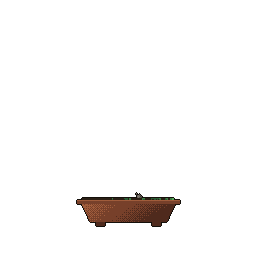

<!-- General Stats Card (Clickable to Generator) -->

### Languages & Core

### Game Engines & IDEs

### Academic Work

> All university course projects are archived in a dedicated organization:  
> 👉 **[@Leon7-Unibo-Projects](https://github.com/Leon7-Unibo-Projects)**

### Git Bonsai

### Connect With Me

  
  

